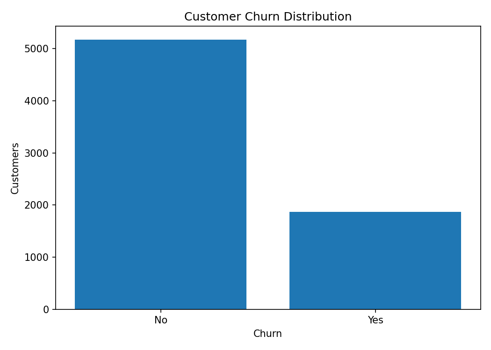
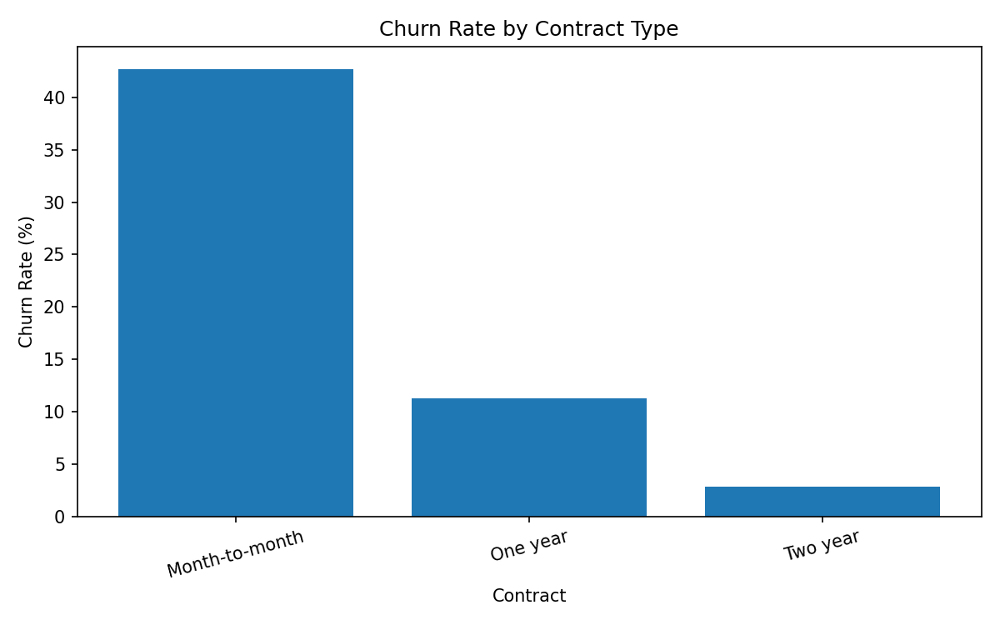
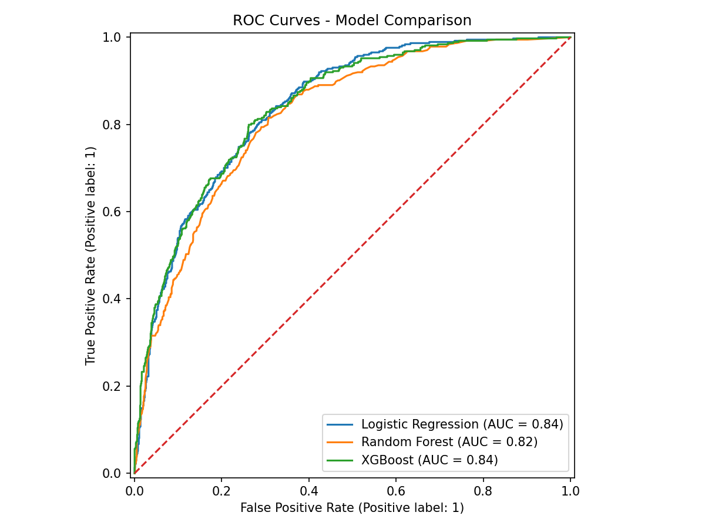
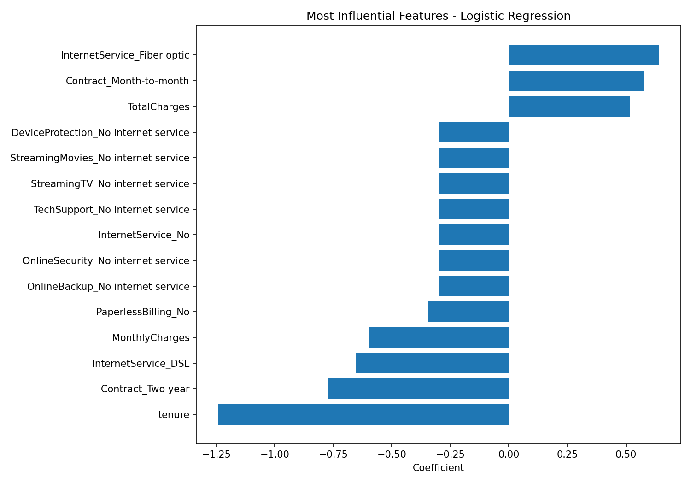

# Customer Churn Prediction

An end-to-end machine learning project for predicting customer churn using the IBM Telco Customer Churn dataset.

## Overview

The dataset contains **7,043 customers and 21 columns** describing demographics, subscribed services, contracts, payment information, charges, and whether the customer churned.

The project covers:

- data quality assessment and cleaning
- exploratory data analysis (EDA)
- categorical encoding and numerical scaling
- leakage-safe preprocessing with scikit-learn pipelines
- Logistic Regression, Random Forest, and XGBoost
- precision, recall, F1-score, ROC-AUC, confusion matrix, and ROC curves
- model interpretation
- business-oriented conclusions

## Dataset

File: `data/WA_Fn-UseC_-Telco-Customer-Churn.csv`

Target: `Churn`

Observed churn rate: **26.54%**

After converting `TotalCharges` to numeric, **11** blank values become missing values. They are handled by median imputation inside the modeling pipeline.

## Exploratory Findings

- Month-to-month contract churn rate: **42.71%**
- One-year contract churn rate: **11.27%**
- Two-year contract churn rate: **2.83%**
- Fiber-optic churn rate: **41.89%**
- DSL churn rate: **18.96%**

These are descriptive associations in this dataset, not causal effects.

## Model Results

| Model | Accuracy | Precision | Recall | F1 | ROC-AUC |
|---|---:|---:|---:|---:|---:|
| Logistic Regression | 0.806 | 0.657 | 0.559 | 0.604 | 0.842 |
| XGBoost | 0.801 | 0.656 | 0.529 | 0.586 | 0.841 |
| Random Forest | 0.781 | 0.617 | 0.465 | 0.530 | 0.822 |

## Selected Model

On the fixed 80/20 stratified split (`random_state=42`), **Logistic Regression** has the highest ROC-AUC at **0.842**. XGBoost is very close, which shows that additional model complexity does not automatically produce a meaningful improvement.

For the selected model, the confusion matrix is:

- True negatives: **926**
- False positives: **109**
- False negatives: **165**
- True positives: **209**

Model selection here is based on a single held-out test split for portfolio demonstration. A production workflow should add cross-validation, hyperparameter tuning, probability calibration, and business-specific threshold optimization.

## Visualizations

### Churn Distribution



### Churn Rate by Contract



### ROC Curves



### Logistic Regression Feature Coefficients



## Project Structure

```text
customer-churn-prediction/
├── charts/
│   ├── churn_distribution.png
│   ├── churn_by_contract.png
│   ├── churn_by_internet_service.png
│   ├── confusion_matrix_best_model.png
│   ├── logistic_feature_coefficients.png
│   └── roc_curves.png
├── data/
│   └── WA_Fn-UseC_-Telco-Customer-Churn.csv
├── .gitignore
├── README.md
├── customer_churn_prediction.ipynb
├── model_results.csv
└── requirements.txt
```

## Technologies

- Python
- pandas
- NumPy
- Matplotlib
- scikit-learn
- XGBoost
- Jupyter Notebook

## How to Run

Create and activate a virtual environment, then install the dependencies:

```bash
pip install -r requirements.txt
```

Start Jupyter:

```bash
jupyter notebook
```

Open `customer_churn_prediction.ipynb` and run all cells from top to bottom.


